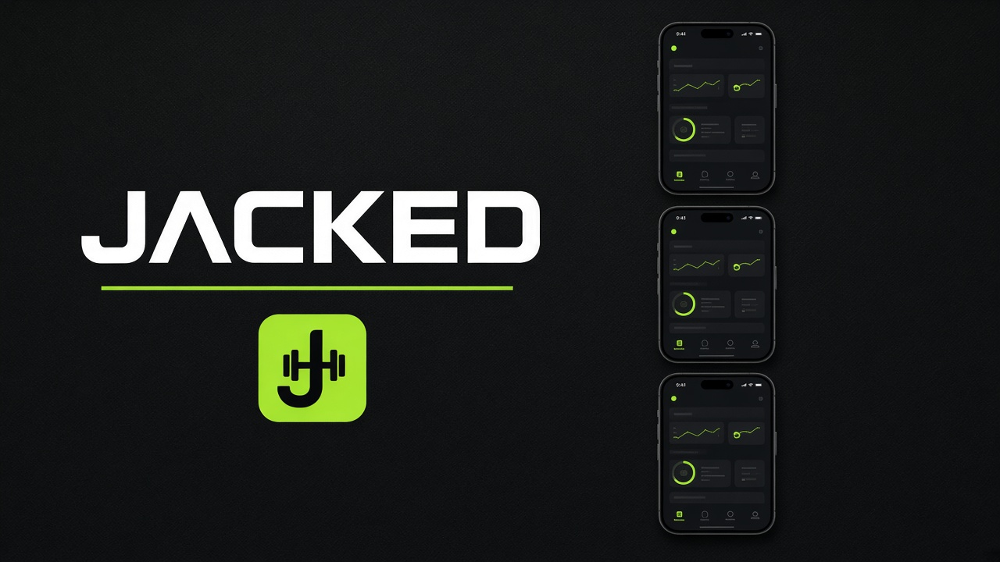
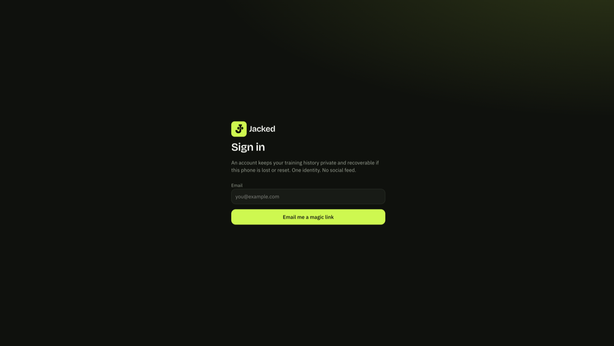
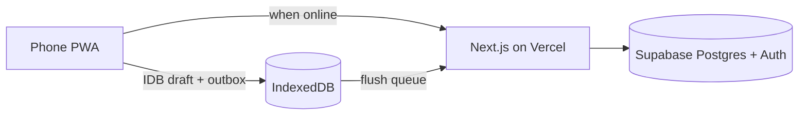

<p align="center">
  
</p>

# Jacked

<p align="center">
  <strong>Personal fitness PWA</strong> — full-body training for rotating shifts.<br/>
  Offline-first logging · Sunday week planner · honest analytics from stored data only.
</p>

<p align="center">
  <a href="https://jacked-gold.vercel.app"></a>
  <a href="https://github.com/9chirla/jacked/actions/workflows/ci.yml"></a>
  
  
  
  
  
</p>

<p align="center">
  
</p>

<p align="center">
  <a href="https://jacked-gold.vercel.app"><strong>Open live app →</strong></a>
</p>

---

## Why

Built for one trainee on rotating shifts: Saturday evening shift drop → Sunday plan three Full Body days (A → B → A) → log on the gym floor with poor signal. No social feed, no LLM coach tax, **$0 stack** (Vercel + Supabase free tiers).

## Features

| Area | What you get |
|------|----------------|
| **Today + planner** | Sunday-start week, free-day chips, live A/B preview, adherence strip |
| **Workout logger** | Keypad-first sets, rest timer, IndexedDB drafts, finish → plan day marked done |
| **Offline** | Outbox queue (sets, sessions, weigh-ins, week plan) + shell SW cache |
| **Progress** | Body weight, measurements, PRs, volume charts (client-only SVG) |
| **Coach** | Rule-based recovery check-in with claim provenance (no LLM required) |
| **Ownership** | JSON / CSV export, schema-versioned import, account delete |

<p align="center">
  
</p>

## Stack

| Layer | Choice |
|-------|--------|
| App | Next.js **16.3.8** (App Router) · React **19.2.3** · TypeScript strict |
| UI | Tailwind CSS v4 · Voltage Lime `#C3FA08` · dark clinical theme |
| Data | Supabase Postgres + Auth (magic link) + RLS |
| Offline | IndexedDB (`idb`) drafts + outbox + service worker shell |
| Hosting | Vercel HTTPS (required for installable PWA) |
| Tests | Vitest · Playwright smoke · GitHub Actions CI |



## Quick start

**Requirements:** Node 22+, a Supabase project, and (for PWA install) HTTPS in production.

```bash
git clone https://github.com/9chirla/jacked.git
cd jacked
cp .env.example .env.local
# fill NEXT_PUBLIC_SUPABASE_URL, NEXT_PUBLIC_SUPABASE_ANON_KEY, SUPABASE_SERVICE_ROLE_KEY
npm install
npm run dev
```

Open [http://localhost:3000](http://localhost:3000).

Apply SQL from `supabase/sql-editor/` in order (`01`…`10`) if the CLI isn’t linked. Prefer `supabase/migrations/` as canonical. `10` adds `week_plan` (Phase 11).

```bash
npm run typecheck && npm test && npm run build
```

## Deploy

1. Push to GitHub → import on Vercel (Framework: Next.js).
2. Set production env:

| Variable | Notes |
|----------|--------|
| `NEXT_PUBLIC_SUPABASE_URL` | Project URL |
| `NEXT_PUBLIC_SUPABASE_ANON_KEY` | Publishable / anon key |
| `NEXT_PUBLIC_APP_URL` | `https://…` no trailing slash |
| `SUPABASE_SERVICE_ROLE_KEY` | Server only (account delete) |
| `ENABLE_DEMO_SEED` | `false` |

3. Supabase Auth → Site URL = `NEXT_PUBLIC_APP_URL`, redirect `{APP_URL}/auth/confirm`.
4. Redeploy after fixing `APP_URL`, then install from Chrome on Android.

Live: **[jacked-gold.vercel.app](https://jacked-gold.vercel.app)**

## Offline model

Writes go **device-first** (IndexedDB outbox), then sync when online. If Supabase is paused or signal is bad, queued sets / weigh-ins / week plans stay on the phone until flush.

| Capability | Offline |
|------------|---------|
| Log sets / finish workout | Queued |
| Body weight | Queued |
| Week plan view / edit | IDB + queued upsert |
| Cached history & charts | Cached range |
| Export / full history search | Needs network |

Settings → Offline: simulate offline, sync queue, install prompt.

## Docs

| File | Contents |
|------|----------|
| [`BUILD_STATE.md`](BUILD_STATE.md) | Phase status |
| [`DECISIONS.md`](DECISIONS.md) | Non-obvious choices |
| [`docs/DATA_MODEL.md`](docs/DATA_MODEL.md) | Schema |
| [`docs/CALCULATIONS.md`](docs/CALCULATIONS.md) | Formulas |
| [`docs/TESTING.md`](docs/TESTING.md) | Suites + gates |
| [`ACCEPTANCE_PHASE11.md`](ACCEPTANCE_PHASE11.md) | Planner phone checklist |
| [`CHANGELOG.md`](CHANGELOG.md) | Releases |
| [`KNOWN_ISSUES.md`](KNOWN_ISSUES.md) | Living debt |

## Status

Phases **0–11** on `main` (weekly planner shipped). Deferred: push notifications (13), native wrapper (14), LLM coach (off by design).

## License

[MIT](LICENSE) © 2026 9chirla
